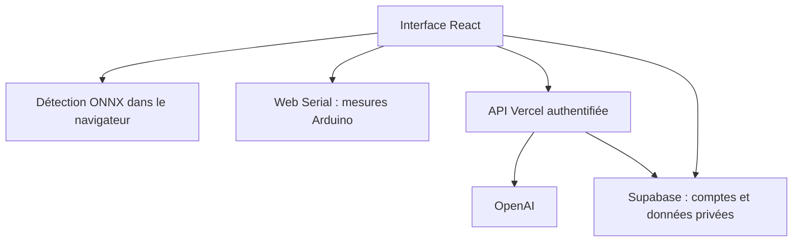
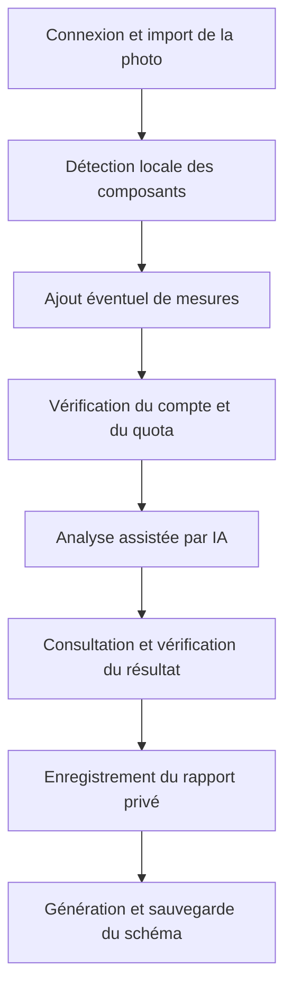

CircuitDiagIA
Application web d'aide à l'analyse de cartes électroniques, avec vision par ordinateur, assistance IA et acquisition de mesures série.

CircuitDiagIA associe l'analyse d'une photographie, la détection locale de composants et des mesures complémentaires pour produire un rapport de diagnostic exploratoire. Les utilisateurs peuvent enregistrer leurs rapports, consulter leur historique et générer des représentations schématiques.

Auteur du projet : Larry Jack Gómez Casalins
Projet personnel reliant l'expérience en électronique au développement web et à l'intégration de l'intelligence artificielle.
Contribution personnelle
Mon travail porte sur :
- La conception de l'architecture du programme et des flux de diagnostic.
- La conception de la base de données, des profils utilisateurs et des historiques privés.
- La conception de la logique d'IA applicative et l'intégration des modèles de vision et de langage dans le parcours d'analyse.
- Le développement du code des interfaces, des services et du traitement des mesures.
- La rédaction de la documentation technique, des diagrammes de flux et des procédures de configuration.
Le projet utilise des modèles et bibliothèques tiers, notamment OpenAI et un modèle de détection PCB exécuté avec ONNX Runtime. Ce dépôt ne documente pas l'entraînement propriétaire de ces modèles ; leur intégration est distincte de la conception de la logique applicative.
Fonctionnalités
- Comptes avec confirmation par courriel et récupération de mot de passe.
- Profil professionnel facultatif : photo, profession, organisation, spécialisation et biographie.
- Analyse d'images de cartes électroniques et détection locale de composants.
- Assistant technique avec prise en charge d'images.
- Connexion série et intégration des mesures dans le parcours de diagnostic.
- Rapports privés avec photographie, résultat, mesures et date.
- Historique, consultation et suppression des rapports.
- Génération et enregistrement de schémas associés aux rapports.
- Guide matériel, export PDF et mode démonstration identifié.
Les profils sont déclaratifs et ne constituent pas une vérification de qualifications professionnelles.
Architecture technique
Couche	Technologies et responsabilité
Interface	React, TypeScript, Vite, Tailwind CSS et Radix UI
Vision locale	Modèle YOLO au format ONNX, exécuté dans le navigateur avec ONNX Runtime Web
API	Fonctions Vercel et modules serveur TypeScript
Assistance IA	API OpenAI appelée exclusivement depuis le serveur
Comptes et données	Supabase Auth, PostgreSQL et stockage privé avec politiques RLS
Matériel	Web Serial et firmware pour Arduino Nano ATmega328P
Tests	Tests TypeScript exécutés avec tsx et le test runner Node.js

Flux d'un diagnostic

Organisation du dépôt
Emplacement	Contenu
src/components	Interface de diagnostic, compte, images et connexion série
src/lib	Détection, mesures, stockage et traitement des réponses
src/pages	Diagnostic et historique
api/[action].ts	Point d'entrée des fonctions Vercel
server	Contrôle d'accès, analyse, conversation et schémas
supabase/setup.sql	Schéma et politiques d'accès
public/models	Modèle ONNX et ressources d'exécution
public/firmware/circuit_diagnostic.ino	Firmware Arduino Nano
tests	Tests applicatifs et scénario SQL de confidentialité

Les principales tables sont profiles, diagnostics, schematics et ai_usage. Les images de diagnostic et les avatars utilisent des espaces de stockage privés.
Installation locale
Prérequis : Node.js 22, npm, un projet Supabase et une clé OpenAI pour les fonctions IA.
git clone https://github.com/Jackfm54/circuitdiagia.git
cd circuitdiagia
npm ci
cp .env.example .env
1. Créer un projet Supabase destiné à cette application.
2. Exécuter supabase/setup.sql une seule fois sur ce nouveau projet. Ne pas relancer le script tel quel sur une base déjà initialisée.
3. Activer l'authentification par courriel et configurer les URL de confirmation et de récupération de mot de passe.
4. Compléter .env avec les variables ci-dessous.
Variable	Utilisation
VITE_SUPABASE_URL	URL Supabase exposée au navigateur
VITE_SUPABASE_PUBLISHABLE_KEY	Clé publique du navigateur
SUPABASE_URL	URL du même projet côté serveur
SUPABASE_PUBLISHABLE_KEY	Clé publique utilisée pour vérifier les accès côté serveur
OPENAI_API_KEY	Clé privée OpenAI, exclusivement côté serveur
OPENAI_MODEL	Modèle compatible avec les images et les outils ; défaut du projet : gpt-4.1

Ne jamais publier .env ni exposer la clé OpenAI avec un préfixe VITE_. La configuration de cette application n'utilise pas de clé Supabase service_role.
# Interface seule : ne fournit pas les fonctions API Vercel
npm run dev

# Interface et fonctions API avec les variables configurées
npx vercel dev
Tests et déploiement
npm test
npm run build
Importer le dépôt dans Vercel avec le préréglage Vite, la commande npm run build et le dossier de sortie dist. Configurer les variables dans l'environnement d'hébergement et ajouter l'URL HTTPS aux redirections Supabase.

Les tests applicatifs s'exécutent sans appel OpenAI. tests/privacy.sql est destiné à une base jetable préparée pour les schémas Auth et Storage ; ne pas l'exécuter en production. La présence des tests ne prouve pas le fonctionnement des services déployés.
Vérifications dans l'environnement déployé
1. Créer un compte, confirmer le courriel et tester la récupération de mot de passe.
2. Enregistrer un profil puis vérifier sa persistance après rechargement.
3. Analyser une image de test, sauvegarder le rapport et le rouvrir depuis l'historique.
4. Générer un schéma pour un rapport enregistré et vérifier sa conservation.
5. Utiliser un second compte pour vérifier l'isolation des rapports et des fichiers.
6. Tester séparément la connexion série avec un montage de mesure adapté.
Matériel et limites
Le firmware fourni vise la Nano classique ATmega328P, à 115 200 bauds, avec A0 activé par défaut. Il mesure uniquement une tension continue : il ne mesure pas directement les résistances, diodes, condensateurs ou la continuité. Fermer le moniteur série avant de connecter le navigateur.

Vérifier le montage au multimètre et respecter la tension admissible de l'entrée. Ne jamais relier directement l'Arduino à une carte sous tension secteur ou à un point inconnu. Les essais physiques demandent une préparation adaptée ; le logiciel ne garantit pas la sécurité électrique du montage.
- Le diagnostic visuel reste une hypothèse à confirmer par des mesures appropriées.
- Le détecteur peut omettre ou confondre des composants ; le schéma est inféré, pas fourni par le fabricant.
- Les images d'entrée sont limitées à 2,5 Mo dans le parcours documenté du projet.
- Le quota de protection est de 50 demandes IA par utilisateur et par jour UTC, configurable dans consume_ai_request. Il ne constitue pas une garantie de coût.
- Le modèle ONNX est téléchargé par le navigateur et peut allonger le premier chargement.
- Les accès, courriels, appels IA et mesures physiques doivent être validés dans l'environnement déployé.
Ressources et licences tierces
Le projet inclut des ressources de détection PCB associées à pcb-component-detection-dataset-yolo, avec l'attribution CC BY 4.0 indiquée dans la documentation préexistante, ainsi qu'ONNX Runtime. Conserver les mentions et licences des dépendances et ressources utilisées.

Les conditions du logiciel Ultralytics et du checkpoint sont distinctes de celles du jeu de données. Vérifier les droits applicables avant une distribution commerciale. Les modèles OpenAI et les ressources tierces ne sont pas présentés comme des créations de l'auteur de l'application.
## Licencias
Se incluyen recursos del modelo PCB (github.com/wangshnegqi/pcb-component-detection-dataset-yolo, atribución CC BY 4.0 indicada en el proyecto original) y ONNX Runtime. Conserva las licencias de dependencias instaladas. El entrenamiento/exportación utiliza el ecosistema Ultralytics: revisa sus condiciones AGPL/comerciales y las del checkpoint antes de distribuir comercialmente; la atribución del dataset no sustituye las licencias del software/modelo. No se ha efectuado una auditoría legal de esas licencias.
